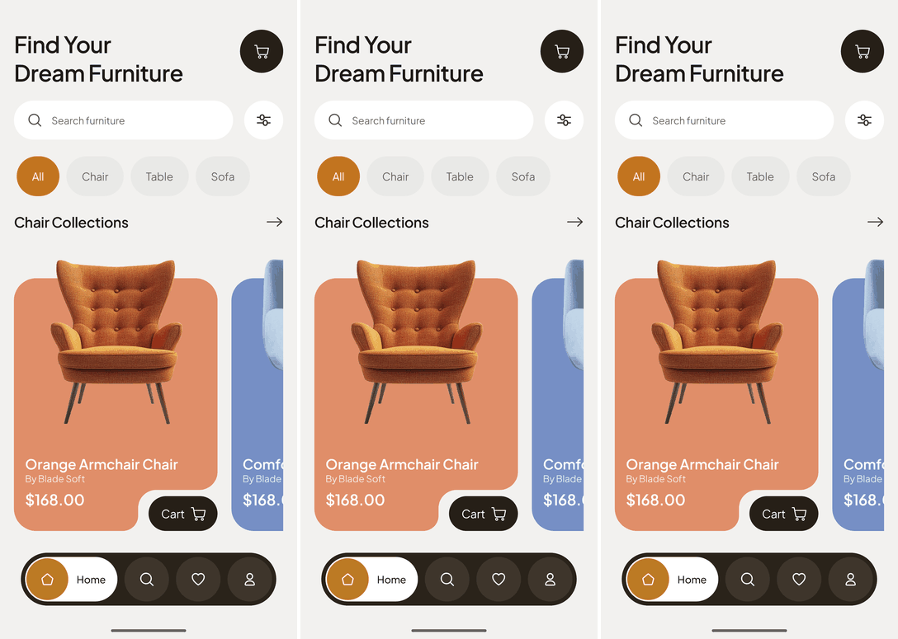
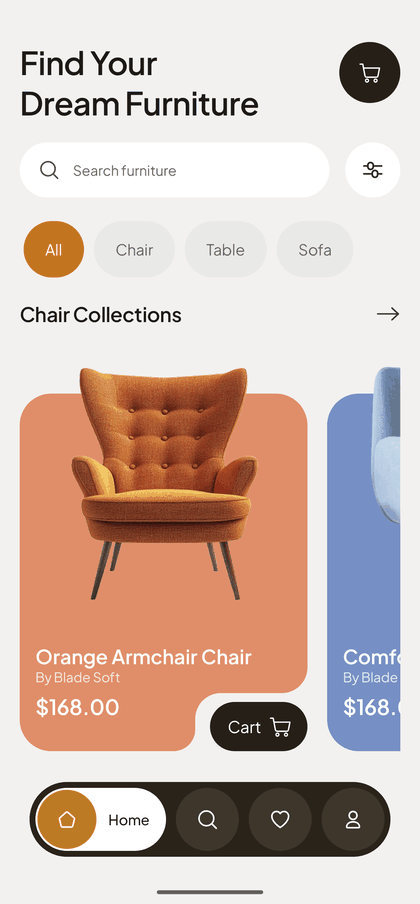
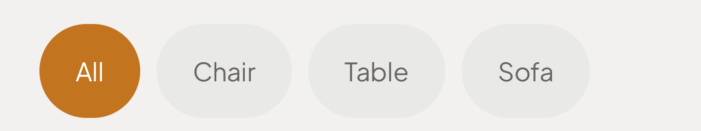
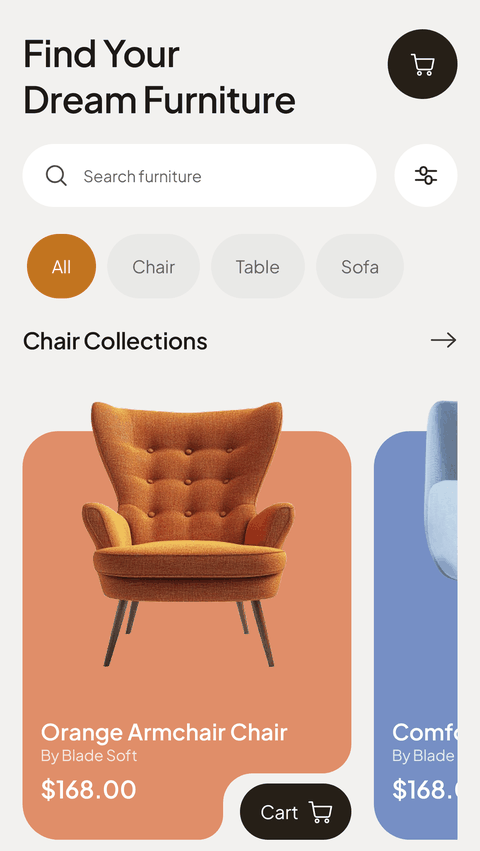
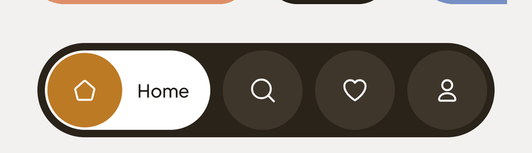

# Furniture Shop Demo 🛋️

A furniture e-commerce home screen built with **Jetpack Compose**, rebuilt pixel-for-pixel from a Figma source design — complete with a custom gooey "add to cart" transfer animation.

UI design inspired by [Modern Furniture Shopping App — Interior Design Mobile UI](https://dribbble.com/shots/27181659-Modern-Furniture-Shopping-App-Interior-Design-Mobile-UI) on Dribbble.

<p align="center">
  
</p>

## ✨ Features

- **Notched product cards** — the "Cart" button slices directly into the card's bottom-right corner through a custom stepped-notch cutout, traced from the original Figma vector path (not an approximation).
- **Gooey "add to cart" transfer effect** — tapping a product's Cart button morphs a color-tinted blob from the button up into the header's cart icon, carrying a small flying thumbnail of the product, and leaves behind a live item-count badge.
- **Gooey category selector & bottom navigation** — both use a liquid, metaball-style sliding indicator (via the [Reactify](https://github.com/veroanggraa/reactify) library) instead of a plain highlight.
- **Horizontal product pager** with peek-next-card paging.
- **Pixel-matched typography** — bundled Plus Jakarta Sans font family, exact colors, spacing, and icon glyphs lifted straight from the Figma file.

<p align="center">
  
</p>

## 🧱 Tech Stack

| Layer | Choice |
|---|---|
| UI | Jetpack Compose + Material 3 |
| Architecture | MVVM (per-feature `ViewModel` + `UiState`) |
| DI | Hilt |
| Navigation | Navigation 3 (`androidx.navigation3`) |
| Async | Kotlin Coroutines & `StateFlow` |
| Animation | [Reactify](https://github.com/veroanggraa/reactify) — gooey/metaball sliding indicators & transfer effects |
| Language | Kotlin |

## 🗂️ Project Structure

The UI follows an **atomic-design** layout on top of a standard **MVVM** feature package:

```
app/src/main/java/com/veroanggra/furnitureshop/
├── data/                  # Product model + repository
├── di/                    # Hilt modules
├── feature/furnitureshop/ # ViewModel, UiState, screen (stateful entry point)
└── ui/
    ├── atoms/             # CartPill, CategoryChip, PriceText, CircleIconButton…
    ├── molecules/         # SearchBar, ScreenHeader, SectionHeader, CategorySelector
    ├── organisms/         # ProductCard, ProductRow, BottomNavigationBar
    ├── templates/         # FurnitureShopTemplate (page-level layout + GooeyTransferHost)
    ├── navigation/        # Nav3 destinations & back stack
    └── theme/             # Colors, typography (Plus Jakarta Sans)
```

## 🚀 Getting Started

1. Clone the repo and open it in **Android Studio** (Quail or newer).
2. Let Gradle sync — the project targets `compileSdk 37` / `minSdk 24`.
3. Run the `app` configuration on an emulator or device.

```bash
./gradlew installDebug
```

## 📸 More Recordings

Additional interaction recordings live in [`recordings/`](recordings):

| What it shows | Preview |
|---|---|
| Switching between All / Chair / Table / Sofa |  |
| Swiping product cards and adding one to the cart |  |
| Home / Search / Wishlist / Profile tab switching |  |
| Full combined walkthrough: categories, two cart adds, and all nav tabs |  |
| Three interactions side-by-side, synchronized in real time |  |
